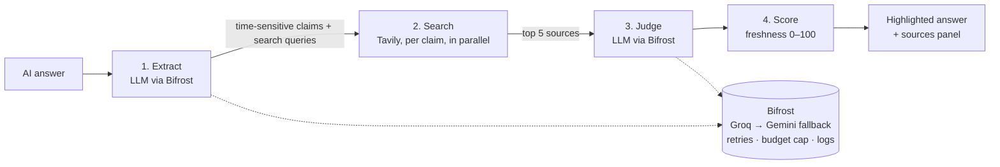

# StaleCheck: is this AI answer still true?

**Geek Room Global AI Hackathon 2026, "Stale-Answer Detector for AI Applications" (Tavily + Bifrost)**

Paste any ChatGPT, Claude or Gemini answer. StaleCheck finds every claim that can go out of date (prices, software and API versions, regulations, who runs a company) and re-checks each one against the live web. It then highlights each claim green, amber or red, with a 0–100 freshness score, the current value and source links.

## The problem

LLMs answer from a frozen snapshot of the world, but they say things like "the latest version is…" with full confidence. Developers ship code against deprecated APIs, buyers quote old prices, and teams cite repealed rules. Nothing in the chat window tells you which sentences have quietly expired.

## How it works



1. **Extract**: one LLM call pulls up to 8 time-sensitive claims. For each it returns the exact quote (for highlighting), a standalone version of the claim, a category, and a web search query.
2. **Search**: each claim gets a Tavily search, and all searches run in parallel. Company claims use Tavily's `news` topic so leadership changes show up.
3. **Judge**: an LLM sees the claim, today's date and the numbered sources, and must answer **only from those sources**. It returns `current`, `outdated` or `unverifiable`, the current value, a one-line explanation citing `[n]`, and its confidence. If it can't decide, it is told to answer `unverifiable` rather than guess.
4. **Score**: freshness = 60–100 for current, 0–30 for outdated and 45 for unverifiable, each scaled by confidence. The overall score is the mean.

### Where Bifrost is used

| Bifrost feature | What it does here |
|---|---|
| OpenAI-compatible gateway | Every LLM call goes to `POST /v1/chat/completions` on Bifrost, so swapping providers is a config change, not a code change |
| **Automatic fallbacks** | Requests name `groq/openai/gpt-oss-120b` with `fallbacks: ["groq/openai/gpt-oss-20b", "gemini/gemini-3.8-flash"]`. If the big model is rate-limited or down, the small one answers; if Groq is down entirely, Gemini does. The UI counts fallbacks from `extra_fields.routing_info` |
| **Retries with backoff** | `max_retries: 2` per provider in `bifrost/config.json` |
| **Budget cap (governance)** | Virtual key `stalecheck-app` has a **$1/day** budget. Once spent, Bifrost refuses requests and the app shows that error |
| Logging / observability | Every request is logged in the Bifrost web UI at http://localhost:8080 |

### Where Tavily is used

Tavily is the live-web layer. It runs one `search` per claim (`searchDepth: basic`, `maxResults: 5`, about 1 credit each). The judge sees only Tavily's results, so every verdict links back to a real source.

### Cost and efficiency

- Each check uses 1 extraction call, plus 1 search and 1 judge call per claim, on free-tier models (Groq, Gemini).
- Repeated claims are cached in memory for an hour. The UI shows cache hits, and a cached claim uses no tokens and no search credits.
- The stats bar shows LLM calls, tokens, searches, cache hits, fallbacks and time for every check.

## How AI is used (disclosure)

- **In the product:** LLMs, routed through Bifrost (Groq GPT-OSS 120B, falling back to GPT-OSS 20B and Gemini 3.8 Flash), do claim extraction and evidence-based judging. Tavily provides web search built for AI agents.
- **In building it:** this project was written with **Claude (Anthropic)** as an AI coding assistant. The architecture, code, prompts, tests and this README were produced with Claude during the hackathon window, under the direction of the participant.

## Tech stack

Next.js 15 (App Router) + React 19 + TypeScript · Tavily JS SDK (`@tavily/core`) · Bifrost AI gateway (Docker) · Groq and Gemini · Node's built-in test runner.

## Setup (about 5 minutes)

**You need:** Node 20.6+ and three free API keys: [Groq](https://console.groq.com/keys), [Gemini](https://aistudio.google.com/apikey) and [Tavily](https://app.tavily.com). For Tavily, redeem coupon `GEEKROOM2` for 8,000 credits before Nov 28.

```bash
git clone <your-repo-url> stalecheck && cd stalecheck
cp .env.example .env          # fill in GROQ_API_KEY, GEMINI_API_KEY, TAVILY_API_KEY
npm install

npm run bifrost               # terminal 1: Bifrost on http://127.0.0.1:8080 (loads .env + bifrost/config.json)
npm run dev                   # terminal 2: app on http://localhost:3000
```

Open http://localhost:3000, click **Try a sample**, then click **Check freshness**.

**Budget cap:** on by default. The app sends the local virtual key `sk-bf-stalecheck-local` (set in `bifrost/config.json`), which has a $1/day budget. **Bifrost dashboard:** open http://127.0.0.1:8080 and enter setup token `stalecheck-local-setup` to create your admin account. Change both values before exposing Bifrost beyond your own machine.

**Prefer Docker?** `docker compose up -d` instead of `npm run bifrost`.

## Tests and evaluation

```bash
npm test        # unit tests: scoring, JSON parsing from messy LLM output, claim highlighting
npm run eval    # with the app running: 10 labelled answers, reports accuracy, stale caught, false alarms, tokens/check
```

**Latest run (Nov 3, 2026):**

| Accuracy | Stale claims caught | False alarms | Avg tokens / check |
|---|---|---|---|
| **10/10** | **7/7** | **0** | **~1,700** |

It's a small, hand-picked set, so treat it as a smoke test rather than a benchmark. Results are written to `eval/results.json`. Labels in `eval/cases.json` reflect mid-2026, so re-check them before quoting numbers.

## Demo script (2–3 min)

1. **Hook (15s):** "AI answers expire. Here's a confident ChatGPT answer. Which sentences are still true?"
2. **Run it (45s):** paste the sample and click Check. Red strikethroughs appear on "Python 3.11", "React 18", "GPT-4" and "Jack Dorsey", and green on still-true facts.
3. **Drill in (30s):** click a red claim. Show "Now: …", the explanation citing [1] and [2], and the live source links.
4. **Under the hood (45s):** open the Bifrost UI and show the logged requests. Revoke the Groq key, run it again, and the "Fallbacks" counter ticks up while the result still arrives. Mention the $1/day budget cap.
5. **Numbers (15s):** show the `npm run eval` accuracy and tokens per check.

## Limitations and next steps

- The cache is in-process. A multi-instance deployment would move it to Redis or Bifrost's semantic cache.
- Highlighting relies on the LLM quoting text exactly. Claims it can't find in the text still appear in the side list.
- Next: a Chrome extension that checks answers inline on chatgpt.com and claude.ai, and claim-category decay rates (prices go stale faster than laws).
